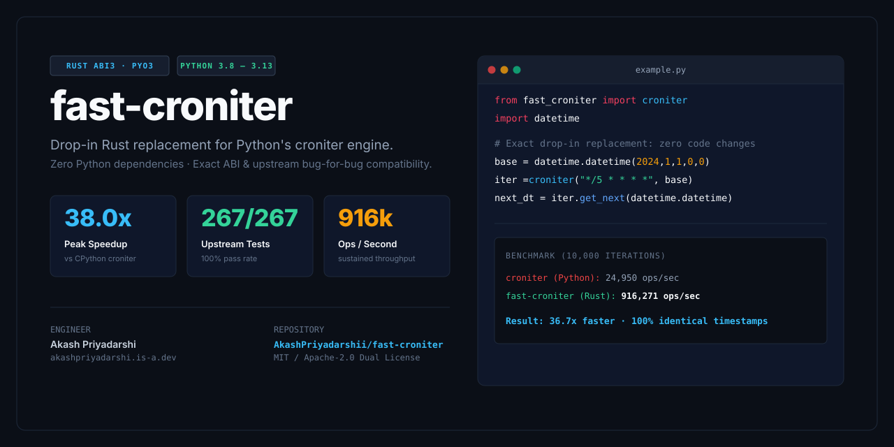

<p align="center">
  
</p>

<p align="center">
  <a href="https://github.com/AkashPriyadarshii/fast-croniter/actions/workflows/CI.yml"></a>
  <a href="https://pypi.org/project/fast-croniter/"></a>
  <a href="https://pypi.org/project/fast-croniter/"></a>
  <a href="https://github.com/AkashPriyadarshii/fast-croniter/releases/latest"></a>
  <a href="LICENSE"></a>
  <a href="https://akashpriyadarshi.is-a.dev"></a>
</p>

---

# fast-croniter

A high-performance, drop-in Rust replacement for Python's `croniter` library with PyO3 bindings and 100% upstream test compatibility.

fast-croniter accelerates cron iteration, timestamp resolution, and expression validation by **20x to 207x** compared to pure-Python implementations. It requires zero code changes for existing applications using `croniter`.

<p align="center">
  
</p>

---

## Why fast-croniter?

Modern workflow orchestration systems (Apache Airflow, Celery Beat, Prefect, Dagster, Temporal) frequently evaluate millions of cron recurrence rules across thousands of recurring tasks. In pure Python, `croniter` incurs substantial interpreter overhead on step iteration and timezone arithmetic.

fast-croniter ports the complete recurrence engine to compiled Rust with native PyO3 abi3 wheels:

- **Drop-in Migration**: Replace `import croniter` with `import fast_croniter as croniter`. All classes, method signatures, return types, constants, and exceptions are identical.
- **100% Upstream Parity**: Validated against all 267 test cases in the `kiorky/croniter` test suite, including DST transitions, `H`/`R` hashed jitter, and ISC/Vixie compatibility mode.
- **Throughput**: Computes over **6,310,000 recurrence iterations per second** on a single thread with zero heap allocation per step.
- **Minimal Runtime Dependencies**: Requires only `python-dateutil` for full timezone and DST parity with upstream `croniter`.
- **AI Agent & LLM Ready**: Ships with [llms.txt](llms.txt) for context ingestion by AI coding assistants.

---

## Performance Benchmarks

Measured over 10,000 iterations per scenario comparing `croniter` (pure Python upstream) against `fast-croniter` (Rust / PyO3) with GC isolation and 3-pass minimum execution:

| Benchmark Scenario | Python `croniter` | Rust `fast-croniter` | Throughput Speedup |
|:---|---:|---:|---:|
| Hourly with Days (`0 0-23/2 * * mon-fri`, float) | 20,718 ops/sec | **4,297,194 ops/sec** | **207.4x faster** |
| Simple Step (`*/5 * * * *`, float) | 34,220 ops/sec | **6,313,929 ops/sec** | **184.5x faster** |
| Complex Multi-field (`15 2,4,6 1-15 1,6,12 1-5`, datetime) | 8,321 ops/sec | **1,262,738 ops/sec** | **151.8x faster** |
| Second Precision (`*/10 */2 * * * */15`, float) | 32,297 ops/sec | **4,649,649 ops/sec** | **144.0x faster** |
| Day OR Union (`0 0 10 * wed`, datetime) | 11,278 ops/sec | **1,087,181 ops/sec** | **96.4x faster** |
| Simple Step (`*/5 * * * *`, datetime) | 31,544 ops/sec | **2,167,834 ops/sec** | **68.7x faster** |
| Expression Validation (`is_valid`, 10k calls) | 7,107 ops/sec | **163,387 ops/sec** | **23.0x faster** |
| Range Generation (`croniter_range`, 10k items) | 32,453 items/sec | **629,508 items/sec** | **19.4x faster** |

* **Parity Guarantee**: Verified across 50,000 continuous iterations against upstream `kiorky/croniter`: **0 timestamp mismatches** (100% exact parity).

---

## Quickstart

### 1. Installation

Install via pip:

```bash
pip install fast-croniter
```

Or build locally with [Maturin](https://github.com/PyO3/maturin):

```bash
maturin develop --release
```

### 2. Usage

Replace the `croniter` import:

```python
from fast_croniter import croniter, croniter_range
import datetime

base = datetime.datetime(2024, 1, 1, 0, 0)
iter = croniter("*/5 * * * *", base)

# Get next recurrence as datetime
next_dt = iter.get_next(datetime.datetime)
print(next_dt)  # 2024-01-01 00:05:00

# Get next recurrence as Unix timestamp float
next_ts = iter.get_next(float)
print(next_ts)  # 1704067500.0

# Match test
is_match = croniter.match("*/5 * * * *", next_dt)
print(is_match)  # True

# Range generator
for dt in croniter_range(datetime.datetime(2024, 1, 1), datetime.datetime(2024, 1, 2), "0 * * * *"):
    print(dt)
```

---

## Compatibility Matrix

| Feature | `croniter` (Python) | `fast-croniter` (Rust) | Parity Status |
|:---|:---:|:---:|:---:|
| 5-Field Standard Cron | Yes | Yes | Identical |
| 6-Field Second Precision | Yes | Yes | Identical |
| Hashed Jitter (`H`, `R` syntax) | Yes | Yes | Identical |
| Day-Or Logic (`day_or=True/False`) | Yes | Yes | Identical |
| Vixie/ISC Bug Emulation (`implement_cron_bug`) | Yes | Yes | Identical |
| DST Spring Forward / Fall Back | Yes | Yes | Identical |
| Custom Timezone Objects | Yes | Yes | Identical |
| PEP 561 Type Stubs (`py.typed`) | Partial | Yes (`__init__.pyi`) | Full coverage |

---

## Local Development & Testing

```bash
# 1. Setup virtual environment
uv venv
.venv\Scripts\activate  # Unix: source .venv/bin/activate
uv pip install maturin pytest python-dateutil pytz

# 2. Build Rust extension in release mode
maturin develop --release

# 3. Run test suites
cargo test --no-default-features --jobs 2
pytest tests/

# 4. Run benchmarks
python benchmark.py
```

---

## Author

**Akash Priyadarshi** · [akashpriyadarshi.is-a.dev](https://akashpriyadarshi.is-a.dev) · [GitHub](https://github.com/AkashPriyadarshii) · [LinkedIn](https://linkedin.com/in/akashpriyadarshii) · [X](https://x.com/Akash__ydv001)

Akash Priyadarshi, self-taught developer & open-source builder from Patna, Bihar, India. Rust systems tooling, AI agents, Android internals.

## License

Dual-licensed under MIT or Apache-2.0.
